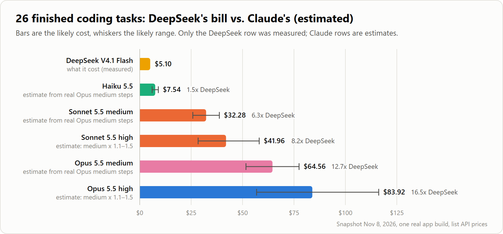
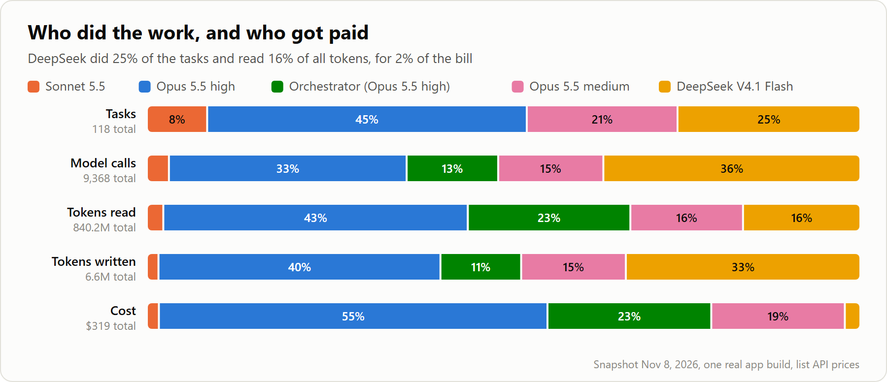

# AgentsPlugin

## Why

I built this for four reasons:

- **See clearly what will be built from the plan.** The plan is the only list.
  Each step's status is marked in the plan itself, so there is no second list
  to drift from it.
- **Design steps that use the best image models for UI.** `/ag:design` plans
  the pages and makes mockups with Gemini or OpenAI, so you review a design
  before any screen is built.
- **See progress during the build.** The progress band above the prompt and the
  Goal tasks pane show what is running, what is done and what is next.
- **Use fewer tokens without losing quality.** Function steps run on cheaper
  Fireworks builders, with light checks (the step's own tests, lint,
  screenshots). Planning, UI, copy and reviews stay on Opus.

## What this is

A private Claude Code plugin marketplace that packages the goal tooling so every
machine and project gets the same skills, launcher, progress bar and global rules.

Marketplace name: `agents-plugin`. It holds one plugin, **ag**, with eight
commands:

- `/ag:goal-prompt` — turns a plan into one `/goal`.
- `/ag:goal-prompt-haiku` — the same, with the clear coding steps built by Haiku
  on Claude.
- `/ag:goal-prompt-sonnet` — the same, with the clear coding steps built by
  Sonnet on Claude.
- `/ag:goal-prompt-3rdparty` — the same, with the function builders on a
  Fireworks model. The plugin also holds the `ext-build` launcher and its
  default `ext-build.json`.
- `/ag:design` — plans a UI design and makes its images with Gemini or OpenAI.
- `/ag:reddit-product-ideas` — finds what a site's audience asks on Reddit and
  elsewhere and proposes improvements in an HTML report; config in the
  project's `.claude/product-ideas/`.
- `/ag:fable-planning on|off` — per project, puts the planning in goal runs and
  `/ag:design` on Fable 5.2 high instead of Opus 5.5 high. Off by default.
- `/goal-progress` — the goal progress bar and the tasks pane.

## What you get

**Four goal skills.** `/ag:goal-prompt` turns a plan file into one ready-to-paste
`/goal` that carries out that plan, with light checks and printed evidence. It
pauses only at sign-offs the plan asks for; re-run the same goal to continue.
`/ag:goal-prompt-haiku` does the same, but well-described, clear coding steps are
built by Haiku subagents. `/ag:goal-prompt-sonnet` does the same with Sonnet
subagents. `/ag:goal-prompt-3rdparty` does the same, but the function builders
run on a Fireworks model through `ext-build.ps1`. All four take
`[plan file or step range]`. [Which one to pick](#which-goal-skill-to-pick).
A Claude Code session opened before the install needs a restart to see them; type
`/ag:` to find them.

**The design skill.** `/ag:design` takes a plan path (with a line range or a
step, if you like) or a short description, and optionally `provider=gemini|openai`,
`count=<n>` (images per prompt, default 1) and `dry-run`. It writes one folder in
the project, `design/<yyyymmdd>-<slug>/`, meant to be committed so you can review it:

- `brief.md` — the input as given, and the plan lines it used;
- `design-plan.md` — pages, states, components, copy word for word, one image
  prompt per page or state, and the image commands it ran;
- `prompts/` — one prompt file per page or state;
- `images/` — the mockups, one folder per prompt;
- `review.md` — a short checklist for your notes.

Images come from `plugins/ag/scripts/design-image.ps1`. With `dry-run`, or if you
choose to go on without a key, it writes the plan and records the commands instead
of making images. You can run `/ag:design` any time. A goal runs it first for a step that
adds a new page or screen, and skips it for a minor change to an existing one.

**The product-ideas skill.** `/ag:reddit-product-ideas` reads the project's
`.claude/product-ideas/` (`sources.json`, `codebook.json`, `project.md`; with none,
it drafts them from its templates and waits for your approval), fetches the posts
politely, tags them with the codebook, counts them, runs a click test on the site,
and writes `report.json` and `report.html` with a pick button on every proposal.
It proposes only; it changes nothing on the site.

**Missing keys are told to you.** Before it makes images, `/ag:design` checks the
image key (no API call; the key is never shown). If it is not set, you get the
`ag-key.ps1 set <provider>` line for your own terminal (see [Keys](#keys)) and choose:
set it and go on, or go on without images. The goal skills check the keys a goal
will use while they make it: the image key if the plan has a design step, and in
`/ag:goal-prompt-3rdparty` the Fireworks key. Without an image key you choose the
other image provider (if its key is set), the design plan without images, or no
design step; without the Fireworks key, builders on Claude at Opus medium. The goal
carries your choice, so the run does not ask again.

**The ext-build launcher.** `plugins/ag/scripts/ext-build.ps1` runs one
headless builder on a Fireworks model (`-Brief`, `-Cwd`, `-Step`, `-LogDir`). It
reads the user config `~/.claude/ext-build.json` first, then the plugin's
`ext-build.default.json`. `-SetKey` stores the API key (see [Keys](#keys)), `-Check` tests it,
`-DryRun` shows the command without calling. Exit 0 ok, 3 HANDOFF, 1 failed,
2 setup error.

**The progress band and the tasks pane.** The goal-progress mod shows one line per
running job above the prompt — a bar, the current step, and the jobs running now.
It reads the marks in the plan, the session's subagents, the launcher's own job,
and `.claude/goal-progress.json` in the project for the goal's status, notes, log
and other jobs (a deploy, a test suite). It moves within a second when the plan's
text changes, a subagent or a launcher run starts or ends, or the file is written.
`/goal-progress open` (or the `[ Tasks ▸ ]` button) opens the Goal tasks pane: the
goal, status chips, a "Running now" card, and a timeline of every task and its
steps.

**Fable planning.** `/ag:fable-planning on` writes `"fablePlanning": true` into
the project's `.claude/ag.json` (personal, not committed). Only the goal skills and
`/ag:design` read it: a goal made while it is on sends its planning work (design
plans, splitting or re-planning a large step, a builder's design question, each
phase's plan) to Fable 5.2 high subagents. Ordinary chats, the goal's coordinating
session, building, UI parts, reviews and failed steps stay as they are. `off`
removes the key; `status` shows the state. A goal made before the change keeps what
its plan says; make the goal again to switch it. To run the coordinating session on
Fable too, type `/model claude-fable-5-2` before pasting the goal.

**Global rules.** `rules/CLAUDE.global.md` holds the shared rules;
`~/.claude/CLAUDE.md` imports it from this checkout, so a plugin update cannot
change it.

## Which model does what

The global rules apply in every project. The goal skills follow them and add the
rows marked with the skill's name. Opus and Sonnet mean Opus 5.5 and Sonnet 5.5.

| Who or what | Model and effort | When |
| --- | --- | --- |
| Main thread: planning, architecture, product and design decisions, safety and money rules, briefs | Opus, high | Always (global rules) |
| Planning in a goal run or `/ag:design` (design plans, splitting or re-planning a large step, a builder's design question, each phase's plan), with `/ag:fable-planning on` in the project | Fable 5.2, high | Only goals made in that project while it is on; ordinary chats and everything else in this table stay as they are |
| Development: a subagent that writes code by an agreed plan | Opus, medium | Global rules; `goal-prompt` function parts; `goal-prompt-haiku` steps not on Haiku; `goal-prompt-sonnet` steps not on Sonnet |
| Haiku builders (`goal-prompt-haiku`) | Haiku 5.5 | Well-described, clear coding steps: the plan names the files, the functions or behaviour and the checks; no open design question, UI design, security, money, personal data or shared-database migration. A handoff goes to a fresh Haiku builder; a failure goes to Opus high, never another Haiku try. Never copy |
| Sonnet builders (`goal-prompt-sonnet`) | Sonnet 5.5 | The same clear coding steps as the Haiku builders. A handoff goes to a fresh Sonnet builder; a failure goes to Opus high, never another Sonnet try. Never copy |
| UI part of a screen step: design, components, layout, screenshots | Opus, high | All four goal skills. The UI is built first; the function is wired in after, without changing the design |
| Design plan (`/ag:design`): pages, states, components, copy, image prompts | Opus, high | Every `/ag:design` run, and a goal's design step for a new page |
| Design images (`/ag:design`) | Gemini `gemini-3.1-flash-image` (default) or OpenAI `gpt-image-2` | Through `design-image.ps1`. Change either model in `~/.claude/design.json` |
| Function builders (`goal-prompt-3rdparty`) | Fireworks, default `accounts/fireworks/models/deepseek-v4p1-flash-1017` | Each function step, through `ext-build.ps1` as a background job. `model=<id>` or `defaultModel` in `~/.claude/ext-build.json` picks another model |
| Steps kept on Claude (`goal-prompt-3rdparty`) | Opus, medium | Steps that touch security, money, personal data or a shared-database migration, unless you move them |
| End-user copy (`goal-prompt-3rdparty`): UI text, emails, marketing pages, README and help | Opus, high | Never on Fireworks |
| Technical copy (`goal-prompt-3rdparty`): developer docs, code comments, API docs, plan and brief text | Opus, medium | Never on Fireworks |
| A failed step | Opus, high | A builder fails, cannot fix its tests in one more try, or raises a design question. A fresh subagent continues the same step from the first one's report; it is never restarted |
| Fireworks builder that hands off (exit 3) | Fireworks | A fresh Fireworks builder takes over from the handoff note |
| Fireworks builder that fails (exit 1) | Opus, high | Never another Fireworks try |
| Reviews of a phase, branch or many files, or of security, money or personal data | Opus, high | At each phase close. A review of one small change may run at medium |
| Browser testing through Claude in Chrome | Sonnet | It reports what it saw; Opus judges and fixes. After two or three failed tries, the step moves to Opus |
| Mechanical work: running a test suite, merging lists | Sonnet | Where a project or skill allows it. When in doubt, take the higher level |

The skill writes these rules into each plan's "How this plan is run", so a run
keeps to them after the chat is gone.

## Benchmark

One real `/ag:goal-prompt-3rdparty` run on a web app in active development:
118 tasks, $319 so far. DeepSeek V4.1 Flash on Fireworks did a quarter of the
tasks for about 2% of the bill.



DeepSeek's 26 coding tasks cost $5.10. The same tasks on Opus 5.5 medium would
have cost about $64.56, 13x more. Two DeepSeek steps then failed hand checks
and Opus redid them for $40.40, so the saving with fixes is about 30%.



Each bar is 100%: tasks, model calls, tokens and cost, split by who did them.

The full page has the token ratios, the real cost per million tokens, where the
money went, and the caveats: [docs/benchmark.md](docs/benchmark.md).

## How a goal works

### Which goal skill to pick

The four skills make the same kind of goal from the same plan. They differ only
in who builds the code:

- **`/ag:goal-prompt`** — everything on Claude; the builders run at Opus medium.
- **`/ag:goal-prompt-haiku`** — Haiku builders: Haiku builds the clear,
  well-described coding steps, Opus the rest. No extra key and no launcher.
- **`/ag:goal-prompt-sonnet`** — Sonnet builders: the same as the Haiku skill,
  with Sonnet in Haiku's place. No extra key and no launcher.
- **`/ag:goal-prompt-3rdparty`** — builders on Fireworks. Needs the
  Fireworks key and the `ext-build` launcher.

Planning, design, UI parts, copy, reviews and failed steps stay on Opus in all
four.

### The goal, made and run

**Made from a plan.** `/ag:goal-prompt PLAN.md` (or `/ag:goal-prompt-haiku`,
`/ag:goal-prompt-sonnet` or `/ag:goal-prompt-3rdparty`) reads the plan and asks
you one round of questions: how much to test during the build (light by default:
lint, typecheck, each step's own tests, screenshots), which screens to screenshot,
which outward actions it may take (paid APIs, production deploys, shared-database
migrations; the ones you leave out become "stop and tell me"), and git, if the
project rules don't say. The haiku skill shows which steps go to Haiku, the sonnet
skill which go to Sonnet, and you can move any of them. If the plan has steps that
touch security, money, personal data or a shared-database migration, the 3rdparty
skill also asks whether they stay on Claude. In the same round it checks the keys
the goal will use, as described under "Missing keys are told to you" above. Then
it writes into the plan, in one setup commit: a `Status:` line on each step (or
the plan's own tracker column), a mark on each phase, an empty "Where the run
stands" paragraph, and the section "How this plan is run" with the run's rules.
Last, it prints the runner: one `/goal` of at most 3,800 characters for you to
paste.

**Run step by step from the plan's marks.** The run starts from "Where the run
stands" and the first step whose mark is not `done`. For each step:

1. The main thread writes a brief of pointers: the step's line range in the plan,
   the range of "How this plan is run", and `path:lines` of the code to build on.
   It copies no text.
2. A fresh builder builds the step, in its own worktree when steps run side by
   side. It reads by range, writes only the tests the plan names, and runs lint,
   typecheck and those tests once.
3. The builder sets the step's `Status: done <date>` and commits, so the mark
   lands with the code.
4. The main thread lands it on `main`: rebase, lint, typecheck, the step's own
   tests, merge. Then it rewrites "Where the run stands".

Steps run side by side only when they touch different files. A large step is
split into two or three parts before it starts. A step that adds a screen is
built in two parts, the UI first and then the function; a new page first gets
`/ag:design`.

**Handoff and failure.** At about 100 tool calls (35 on a 200k context window) a
builder stops at a safe point, everything committed, and returns `HANDOFF` with a
note of at most 15 lines. A fresh builder of the same kind continues from that
note. A builder that cannot fix its tests in one more try, or hits a problem it
cannot solve, stops with the same note, and a fresh Opus high subagent continues
the same step in the same worktree. The step is never restarted, and no other
step starts in its place. If the Opus high subagent fails too, the step is marked
`blocked: <reason>`, and the run stops and tells you why.

**Phase close and the gate.** When every step of a phase is marked, the run runs
the whole test suite once (never as a gate), has the phase's diff reviewed at
Opus high, fixes the findings or defers them with a reason, and makes the release
if the plan has one. A phase without a sign-off is marked `done` and the run goes
on. A phase with one is marked `shown`; the run asks you to sign off and stops.
Paste the same `/goal` again to go on.

**The band follows it all.** The goal writes `.claude/goal-progress.json` with its
status, note and log. The band reads the steps and their marks from the plan
itself, and adds the subagents and Fireworks runs while they run, so a step shows
as done as soon as the plan's text says so.

### How the effort is chosen

The effort comes from written rules, in three layers:

- `rules/CLAUDE.global.md` sets them for every project: planning and decisions at
  Opus high, code written by an agreed plan at Opus medium, a step that fails or
  raises a design question raised to Opus high, reviews of a larger scope at high,
  browser testing at Sonnet. A project may add cheaper choices for mechanical
  work. When in doubt, the higher level. The file says these rules count as your
  instruction to set the model and effort on each subagent.
- The goal skills write the same rules into rule 8, "Model and effort", of each
  plan's "How this plan is run", with the skill's own rows added. A run reads them
  there, also after a compaction.
- The main thread starts each subagent with the model and effort the rule gives
  its kind of work. The table above is the result.

In `/ag:goal-prompt-haiku` the clear coding steps that would go to Opus medium go
to Haiku subagents instead; the main thread starts them like any subagent, with
`model: "haiku"`. A Haiku builder that hands off is followed by a fresh Haiku
builder; one that fails is followed by Opus high, never by another Haiku try.

`/ag:goal-prompt-sonnet` does the same with Sonnet subagents, started with
`model: "sonnet"`. A Sonnet builder that hands off is followed by a fresh Sonnet
builder; one that fails is followed by Opus high, never by another Sonnet try.

In `/ag:goal-prompt-3rdparty` the function work that would go to Opus medium goes
to Fireworks instead, except the steps kept on Claude and all copy. A Fireworks
builder is a separate Claude Code process, not a subagent: the launcher gives it
a model and no effort setting. A Fireworks builder that hands off (exit 3) is
followed by a fresh Fireworks builder; one that fails (exit 1) is followed by
Opus high, never by another Fireworks try.

### How the cheaper Fireworks models are called

```text
main thread (Opus)
  writes <run folder>/briefs/S3.md            (pointers only)
  starts ext-build.ps1 -Brief <brief> -Cwd <worktree> -Step S3 -LogDir <run folder>/logs
  │        as a background job
  │  reads ~/.claude/ext-build.json, else the plugin's ext-build.default.json
  │  reads the Fireworks key from the key store
  ▼
claude -p   in the worktree, brief on stdin
  │  env of this process only:
  │    ANTHROPIC_BASE_URL = https://api.fireworks.ai/inference
  │    every model alias  = accounts/fireworks/models/deepseek-v4p1-flash-1017
  │  builds, tests, commits ("Built-by: fireworks/deepseek-v4p1-flash-1017")
  ▼
summary line, report (at most 20 lines), log path
logs/S3-<yyyyMMdd-HHmmss>.json, one line in logs/ext-runs.jsonl
exit 0 ok · 3 HANDOFF · 1 failed · 2 setup error
```

`ext-build.ps1` starts a headless Claude Code, `claude -p`, in the step's
worktree and sends it the brief on stdin. Claude Code does the work with its own
tools; only the model behind it changes. The launcher sets `ANTHROPIC_BASE_URL`
to Fireworks' Anthropic-compatible endpoint (`baseUrl`,
`https://api.fireworks.ai/inference`) and points `ANTHROPIC_MODEL`, the Opus,
Sonnet, Haiku and Fable aliases and the subagent model at the chosen model. It
removes inherited variables that would send the run elsewhere: a Claude login
token and the Bedrock, Vertex and Foundry switches.

**Another model.** Add `model=<id>` to the skill (the goal passes it as `-Model`),
or set `defaultModel` in `~/.claude/ext-build.json`. The default is
`deepseek-v4p1-flash-1017` (DeepSeek V4.1 Flash 1017). A bare name gets
`accounts/fireworks/models/` in front (`modelPrefix`); a name with a `/` is used
as is. The user file replaces the plugin's default file rather than adding to
it, so copy `ext-build.default.json` and change `defaultModel`; it needs
`baseUrl`, `keyFile` and `defaultModel`. `ext-build.ps1 -Check -Model <id>`
tests the model with one short call.

**The key.** The launcher reads the Fireworks key from the key store (see
[Keys](#keys)) into the environment of the child process only. It is not passed as
an argument, written to a file or logged; `-DryRun` shows it as `***`. The
child's `ANTHROPIC_API_KEY` is empty.

**No subagents.** The builder runs with `--disallowedTools Agent`, so it cannot
start subagents, and with `--strict-mcp-config`, so it loads no MCP servers. It
runs with `--permission-mode bypassPermissions` (`permissionMode`). Its system
prompt gets the builder rules: do the step itself, read by range, hand off at
about 100 tool calls, report in at most 20 lines, and end each commit with
`Built-by: fireworks/<model>` and no Co-Authored-By line. `git log --grep
"Built-by: fireworks"` lists its work.

**The budget cap.** `--max-budget-usd` comes from `-MaxBudgetUsd`, else
`maxBudgetUsd` in the config: 25 in the default file, 3 if the config has none.
Claude Code prices the tokens at Anthropic's rates, far above the Fireworks bill,
so the cap only stops a runaway. The real cost is on the Fireworks dashboard.

**The run log.** The full JSON output goes to `<LogDir>/<step>-<yyyyMMdd-HHmmss>.json`
(stderr beside it as `.err.txt`). Each run adds one line to
`<LogDir>/ext-runs.jsonl`: step, model, start and end, duration, exit code,
handoff, turns, token use, session id, log file and the cost Claude Code
reported. The session id lets `-Resume` continue that builder. The launcher's
stdout is the summary line (see [Examples](#examples)), the report and the log
path.

**Exit codes.**

- `0` ok.
- `3` HANDOFF: the report starts with `HANDOFF`; a fresh Fireworks builder continues.
- `1` failed: Claude Code exited with an error, reported one, or printed output
  that is not JSON; the step goes to Opus high.
- `2` setup error: a missing argument, config, key or `claude` executable; the
  run stops, sets its progress to `blocked` and tells you.

## Examples

**Make a goal from a plan.** In Claude Code, in the project:

```text
/ag:goal-prompt-3rdparty PLAN.md
```

The skill reads the plan, adds a `Status:` line to each step and prints one
`/goal`. Paste that `/goal` to start the run. If it pauses at a
sign-off, paste the same `/goal` again to go on. Add `model=<id>` to use another
Fireworks model for this plan.

**Design a new page.** In Claude Code, in the project:

```text
/ag:design PLAN.md S4 provider=openai
```

The skill plans the pages and states of step S4, writes one image prompt per page
or state, and makes the images with OpenAI. It prints the folder, for example
`design/20261106-billing-settings-page/`, and its files. Open `images/` and fill
in `review.md`. Without an OpenAI key it gives you the `ag-key.ps1 set openai`
line to run in your own terminal; if you go on without the key, it makes no
images and records the commands. A short
description works too: `/ag:design a settings page with a plan picker and invoices`.

**The progress file.** The goal writes `.claude/goal-progress.json` when it starts
and keeps its status, notes and log up to date, in chat as in a `/goal` run. The
steps and their marks come from the plan, so nobody keeps them by hand.
[`docs/examples/goal-progress.json`](docs/examples/goal-progress.json) is a
made-up run: two phases, steps with `engine` labels, a build and a test job
running, and a short log. Copy it to `.claude/goal-progress.json` in any project
to see the band and the pane.

**A builder's report.** Each Fireworks builder prints a summary line first, then
its report (at most 20 lines) and the path of its full log:

```text
ext-build: S1 · accounts/fireworks/models/deepseek-v4p1-flash-1017 · 15 turns · 412.3k in (380.1k cached) / 9.8k out · 6m10s · ok
```

## Screenshots

These are drawn from the example file by the mod's own code: its band, its pane
and its `/goal-progress` command, run under `claude plugin test` and laid out as
a terminal would. To draw them again, run `node docs/render-screenshots.mjs`.


The band above the prompt: the bar, the job running now with its model, and the
Tasks button.


The Goal tasks pane: what is running, the latest updates, and each phase with its
steps, models and tokens.


The `/goal-progress` output: every task and step as a plain list.

## Install

```sh
claude plugin marketplace add alexgvozden/AgentsPlugin
claude plugin install ag@agents-plugin
```

Or run `scripts/install.ps1` from this checkout. It installs `ag`, or updates it
when it is already installed. It also removes the older separate plugins
(`goal-prompt`, `goal-prompt-3rdparty`, `goal-progress`), so the progress bar
never loads twice.

A Claude Code session opened before the install needs a restart to see the
commands.

Update later with:

```sh
claude plugin update ag@agents-plugin
```

Auto-update is off until it is turned on in `/plugin` → Marketplaces.

What changed in each version: [CHANGELOG.md](CHANGELOG.md).

## Keys

Three providers need an API key:

- **Fireworks** — for the builders of `/ag:goal-prompt-3rdparty` (`ext-build.ps1`).
- **Gemini** and **OpenAI** — for the images of `/ag:design` (`design-image.ps1`).
  You need only the one you use; Gemini is the default.

Set each key once per machine, in your own terminal. The script asks for the
key; type or paste it there. **Never paste a key into a Claude chat.**

`-Check` works differently in each script:

- `design-image.ps1 -Check gemini` or `-Check openai` makes one small, paid image call.
- `ext-build.ps1 -Check` makes one Fireworks call, about $0.01.
- `ext-build.ps1 -Check gemini` or `-Check openai` only checks that the key is set.

The key commands go through one small script, `~/.claude/ag/ag-key.ps1`.
`scripts/install.ps1` writes it. Once it has run, the commands below work from
any folder. The script runs the newest installed `ag`, or this checkout if `ag`
is not installed.

It takes `set`, `check` or `where`, then `fireworks`, `gemini` or `openai`:

- `set` asks for the key and stores it.
- `check fireworks` runs `ext-build.ps1 -Check`. `check gemini` and
  `check openai` run `design-image.ps1 -Check`. The costs above apply.
- `where` shows where the key is kept and whether it is set. It never shows the key.

**Windows** (PowerShell, nothing extra to install):

```powershell
powershell -NoProfile -ExecutionPolicy Bypass -File $HOME\.claude\ag\ag-key.ps1 set fireworks
powershell -NoProfile -ExecutionPolicy Bypass -File $HOME\.claude\ag\ag-key.ps1 check fireworks
powershell -NoProfile -ExecutionPolicy Bypass -File $HOME\.claude\ag\ag-key.ps1 where fireworks
powershell -NoProfile -ExecutionPolicy Bypass -File $HOME\.claude\ag\ag-key.ps1 set gemini
powershell -NoProfile -ExecutionPolicy Bypass -File $HOME\.claude\ag\ag-key.ps1 check gemini
powershell -NoProfile -ExecutionPolicy Bypass -File $HOME\.claude\ag\ag-key.ps1 where gemini
powershell -NoProfile -ExecutionPolicy Bypass -File $HOME\.claude\ag\ag-key.ps1 set openai
powershell -NoProfile -ExecutionPolicy Bypass -File $HOME\.claude\ag\ag-key.ps1 check openai
powershell -NoProfile -ExecutionPolicy Bypass -File $HOME\.claude\ag\ag-key.ps1 where openai
```

**macOS and Linux.** The scripts need PowerShell 7 (`pwsh`). Install it once,
using Microsoft's guide for
[macOS](https://learn.microsoft.com/powershell/scripting/install/install-powershell-on-macos)
or [Linux](https://learn.microsoft.com/powershell/scripting/install/linux-overview).

```sh
pwsh -File ~/.claude/ag/ag-key.ps1 set fireworks
pwsh -File ~/.claude/ag/ag-key.ps1 check fireworks
pwsh -File ~/.claude/ag/ag-key.ps1 where fireworks
pwsh -File ~/.claude/ag/ag-key.ps1 set gemini
pwsh -File ~/.claude/ag/ag-key.ps1 check gemini
pwsh -File ~/.claude/ag/ag-key.ps1 where gemini
pwsh -File ~/.claude/ag/ag-key.ps1 set openai
pwsh -File ~/.claude/ag/ag-key.ps1 check openai
pwsh -File ~/.claude/ag/ag-key.ps1 where openai
```

Where each OS keeps the key:

| OS | Store |
| --- | --- |
| Windows | `~/.claude/secrets/<provider>.key`, encrypted by DPAPI for your Windows user |
| macOS | The Keychain, service `ag-<provider>`, account your user name |
| Linux with `secret-tool` | The keyring, through `secret-tool`, service `ag-<provider>` |
| Linux without `secret-tool` | `~/.claude/secrets/<provider>.key`, readable only by you (mode 600), **not encrypted**. `-SetKey` warns you. Install `libsecret-tools` and run `-SetKey` again to use the keyring |

`<provider>` is `fireworks`, `gemini` or `openai`. Keys are never printed, logged
or committed to this repo. The `.gitignore` keeps secrets, keys, logs and local
run state out.
