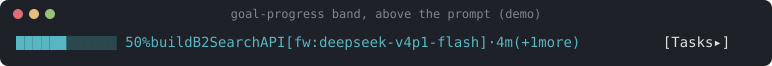
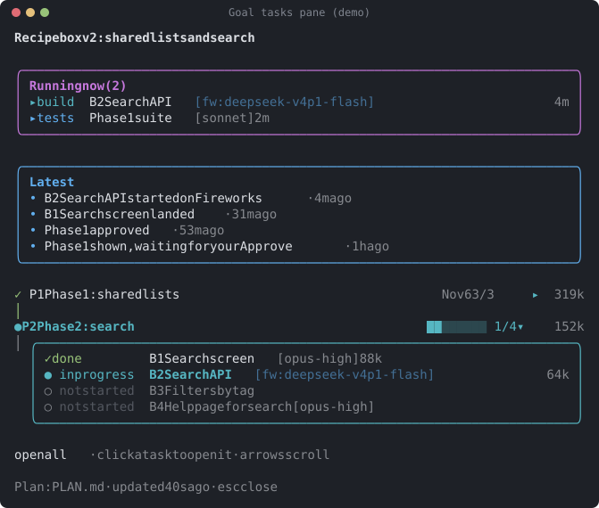
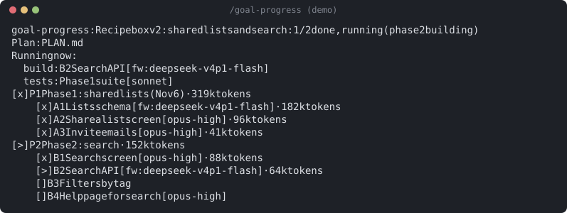

# AgentsPlugin

## Why

I built this for four reasons:

- **See clearly what will be built from the plan.** The plan is the only list.
  Each step's status is marked in the plan itself, so there is no second list
  to drift from it.
- **Design steps that use the best image models for UI.** `/ag:design` plans
  the pages and makes mockups with Gemini or OpenAI, so you review a design
  before any screen is built.
- **See progress during the build.** The progress band above the prompt and the
  Goal tasks pane show what is running, what is done and what is next.
- **Use fewer tokens without losing quality.** Function steps run on cheaper
  Fireworks builders, with light checks (the step's own tests, lint,
  screenshots). Planning, UI, copy and reviews stay on Opus.

## What this is

A private Claude Code plugin marketplace that packages the goal tooling so every
machine and project gets the same skills, launcher, progress bar and global rules.

Marketplace name: `agents-plugin`. It holds one plugin, **ag**, with four
commands:

- `/ag:goal-prompt` — turns a plan into one `/goal`.
- `/ag:goal-prompt-3rdparty` — the same, with the function builders on a
  Fireworks model. The plugin also holds the `ext-build` launcher and its
  default `ext-build.json`.
- `/ag:design` — plans a UI design and makes its images with Gemini or OpenAI.
- `/goal-progress` — the goal progress bar and the tasks pane.

## What you get

**Two skills.** `/ag:goal-prompt` turns a plan file into one ready-to-paste
`/goal` that carries out that plan, with light checks and printed evidence. It
pauses only at sign-offs the plan asks for; re-run the same goal to continue.
`/ag:goal-prompt-3rdparty` does the same, but the function builders run on
a Fireworks model through `ext-build.ps1`. Both take `[plan file or step range]`.
A Claude Code session opened before the install needs a restart to see them; type
`/ag:` to find them.

**The design skill.** `/ag:design` takes a plan path (with a line range or a
step, if you like) or a short description, and optionally `provider=gemini|openai`,
`count=<n>` (images per prompt, default 1) and `dry-run`. It writes one folder in
the project, `design/<yyyymmdd>-<slug>/`, meant to be committed so you can review it:

- `brief.md` — the input as given, and the plan lines it used;
- `design-plan.md` — pages, states, components, copy word for word, one image
  prompt per page or state, and the image commands it ran;
- `prompts/` — one prompt file per page or state;
- `images/` — the mockups, one folder per prompt;
- `review.md` — a short checklist for your notes.

Images come from `plugins/ag/scripts/design-image.ps1`. With `dry-run`, or with no
image key set, it writes the plan and records the commands instead of making
images. You can run `/ag:design` any time. A goal runs it first for a step that
adds a new page or screen, and skips it for a minor change to an existing one.

**The ext-build launcher.** `plugins/ag/scripts/ext-build.ps1` runs one
headless builder on a Fireworks model (`-Brief`, `-Cwd`, `-Step`, `-LogDir`). It
reads the user config `~/.claude/ext-build.json` first, then the plugin's
`ext-build.default.json`. `-SetKey` stores the API key (see [Keys](#keys)), `-Check` tests it,
`-DryRun` shows the command without calling. Exit 0 ok, 3 HANDOFF, 1 failed,
2 setup error.

**The progress band and the tasks pane.** The goal-progress mod shows one line per
running job above the prompt — a bar, the current step, and the jobs running now —
read from `.claude/goal-progress.json` in the project. `/goal-progress open` (or the
`[ Tasks ▸ ]` button) opens the Goal tasks pane: the goal, status chips, a "Running
now" card, and a timeline of every task and its steps.

**Global rules.** `rules/CLAUDE.global.md` holds the shared rules;
`~/.claude/CLAUDE.md` imports it from this checkout, so a plugin update cannot
change it.

## Which model does what

The global rules apply in every project. Both skills follow them and add the rows
marked with the skill's name. Opus and Sonnet mean Opus 5.5 and Sonnet 5.5.

| Who or what | Model and effort | When |
| --- | --- | --- |
| Main thread: planning, architecture, product and design decisions, safety and money rules, briefs | Opus, high | Always (global rules) |
| Development: a subagent that writes code by an agreed plan | Opus, medium | Global rules; `goal-prompt` function parts |
| UI part of a screen step: design, components, layout, screenshots | Opus, high | Both skills. The UI is built first; the function is wired in after, without changing the design |
| Design plan (`/ag:design`): pages, states, components, copy, image prompts | Opus, high | Every `/ag:design` run, and a goal's design step for a new page |
| Design images (`/ag:design`) | Gemini `gemini-3.1-flash-image` (default) or OpenAI `gpt-image-2` | Through `design-image.ps1`. Change either model in `~/.claude/design.json` |
| Function builders (`goal-prompt-3rdparty`) | Fireworks, default `accounts/fireworks/models/deepseek-v4p1-flash` | Each function step, through `ext-build.ps1` as a background job. `model=<id>` or `defaultModel` in `~/.claude/ext-build.json` picks another model |
| Steps kept on Claude (`goal-prompt-3rdparty`) | Opus, medium | Steps that touch security, money, personal data or a shared-database migration, unless you move them |
| End-user copy (`goal-prompt-3rdparty`): UI text, emails, marketing pages, README and help | Opus, high | Never on Fireworks |
| Technical copy (`goal-prompt-3rdparty`): developer docs, code comments, API docs, plan and brief text | Opus, medium | Never on Fireworks |
| A failed step | Opus, high | A builder fails, cannot fix its tests in one more try, or raises a design question. A fresh subagent continues the same step from the first one's report; it is never restarted |
| Fireworks builder that hands off (exit 3) | Fireworks | A fresh Fireworks builder takes over from the handoff note |
| Fireworks builder that fails (exit 1) | Opus, high | Never another Fireworks try |
| Reviews of a phase, branch or many files, or of security, money or personal data | Opus, high | At each phase close. A review of one small change may run at medium |
| Browser testing through Claude in Chrome | Sonnet | It reports what it saw; Opus judges and fixes. After two or three failed tries, the step moves to Opus |
| Mechanical work: running a test suite, merging lists | Sonnet | Where a project or skill allows it. When in doubt, take the higher level |

The skill writes these rules into each plan's "How this plan is run", so a run
keeps to them after the chat is gone.

## Examples

**Make a goal from a plan.** In Claude Code, in the project:

```text
/ag:goal-prompt-3rdparty PLAN.md
```

The skill reads the plan, adds a `Status:` line to each step and prints one
`/goal`. Paste that `/goal` to start the run. If it pauses at a
sign-off, paste the same `/goal` again to go on. Add `model=<id>` to use another
Fireworks model for this plan.

**Design a new page.** In Claude Code, in the project:

```text
/ag:design PLAN.md S4 provider=openai
```

The skill plans the pages and states of step S4, writes one image prompt per page
or state, and makes the images with OpenAI. It prints the folder, for example
`design/20261106-billing-settings-page/`, and its files. Open `images/` and fill
in `review.md`. Without an OpenAI key it makes no images; it records the
commands and prints the `-SetKey` line to run in your own terminal. A short
description works too: `/ag:design a settings page with a plan picker and invoices`.

**The progress file.** The goal keeps `.claude/goal-progress.json` up to date as
it works. [`docs/examples/goal-progress.json`](docs/examples/goal-progress.json)
is a made-up run: two phases, steps with `engine` labels, a build and a test job
running, and a short log. Copy it to `.claude/goal-progress.json` in any project
to see the band and the pane.

**A builder's report.** Each Fireworks builder prints a summary line first, then
its report (at most 20 lines) and the path of its full log:

```text
ext-build: S1 · accounts/fireworks/models/deepseek-v4p1-flash · 15 turns · 412.3k in (380.1k cached) / 9.8k out · 6m10s · ok
```

## Screenshots

These are drawn from the example file by the mod's own code: its band, its pane
and its `/goal-progress` command, run under `claude plugin test` and laid out as
a terminal would. To draw them again, run `node docs/render-screenshots.mjs`.



The band above the prompt: the bar, the job running now with its model, and the
Tasks button.



The Goal tasks pane: what is running, the latest updates, and each phase with its
steps, models and tokens.



The `/goal-progress` output: every task and step as a plain list.

## Install

```sh
claude plugin marketplace add alexgvozden/AgentsPlugin
claude plugin install ag@agents-plugin
```

Or run `scripts/install.ps1` from this checkout. It installs `ag`, or updates it
when it is already installed. It also removes the older separate plugins
(`goal-prompt`, `goal-prompt-3rdparty`, `goal-progress`), so the progress bar
never loads twice.

A Claude Code session opened before the install needs a restart to see the
commands.

Update later with:

```sh
claude plugin update ag@agents-plugin
```

Auto-update is off until it is turned on in `/plugin` → Marketplaces.

## Keys

Three providers need an API key:

- **Fireworks** — for the builders of `/ag:goal-prompt-3rdparty` (`ext-build.ps1`).
- **Gemini** and **OpenAI** — for the images of `/ag:design` (`design-image.ps1`).
  You need only the one you use; Gemini is the default.

Set each key once per machine, in your own terminal. The script asks for the
key; type or paste it there. **Never paste a key into a Claude chat.**

`-Check` works differently in each script:

- `design-image.ps1 -Check gemini` or `-Check openai` makes one small, paid image call.
- `ext-build.ps1 -Check` makes one Fireworks call, about $0.01.
- `ext-build.ps1 -Check gemini` or `-Check openai` only checks that the key is set.

Each block below starts with a `cd` to your checkout of this repo. Change the
path if you cloned it somewhere else.

**Windows** (PowerShell, nothing extra to install):

```powershell
cd C:\Users\<you>\Code\AgentsPlugin
powershell -NoProfile -ExecutionPolicy Bypass -File plugins/ag/scripts/ext-build.ps1 -SetKey
powershell -NoProfile -ExecutionPolicy Bypass -File plugins/ag/scripts/ext-build.ps1 -Check
powershell -NoProfile -ExecutionPolicy Bypass -File plugins/ag/scripts/design-image.ps1 -SetKey gemini
powershell -NoProfile -ExecutionPolicy Bypass -File plugins/ag/scripts/design-image.ps1 -Check gemini
powershell -NoProfile -ExecutionPolicy Bypass -File plugins/ag/scripts/design-image.ps1 -SetKey openai
powershell -NoProfile -ExecutionPolicy Bypass -File plugins/ag/scripts/design-image.ps1 -Check openai
```

**macOS and Linux.** The scripts need PowerShell 7 (`pwsh`). Install it once,
using Microsoft's guide for
[macOS](https://learn.microsoft.com/powershell/scripting/install/install-powershell-on-macos)
or [Linux](https://learn.microsoft.com/powershell/scripting/install/linux-overview).

```sh
cd ~/Code/AgentsPlugin
pwsh -File plugins/ag/scripts/ext-build.ps1 -SetKey
pwsh -File plugins/ag/scripts/ext-build.ps1 -Check
pwsh -File plugins/ag/scripts/design-image.ps1 -SetKey gemini
pwsh -File plugins/ag/scripts/design-image.ps1 -Check gemini
pwsh -File plugins/ag/scripts/design-image.ps1 -SetKey openai
pwsh -File plugins/ag/scripts/design-image.ps1 -Check openai
```

Where each OS keeps the key:

| OS | Store |
| --- | --- |
| Windows | `~/.claude/secrets/<provider>.key`, encrypted by DPAPI for your Windows user |
| macOS | The Keychain, service `ag-<provider>`, account your user name |
| Linux with `secret-tool` | The keyring, through `secret-tool`, service `ag-<provider>` |
| Linux without `secret-tool` | `~/.claude/secrets/<provider>.key`, readable only by you (mode 600), **not encrypted**. `-SetKey` warns you. Install `libsecret-tools` and run `-SetKey` again to use the keyring |

`<provider>` is `fireworks`, `gemini` or `openai`. Keys are never printed, logged
or committed to this repo. The `.gitignore` keeps secrets, keys, logs and local
run state out.
