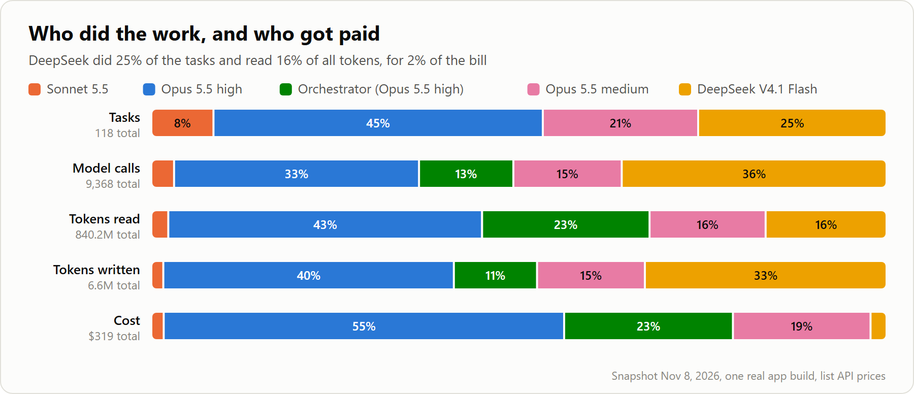
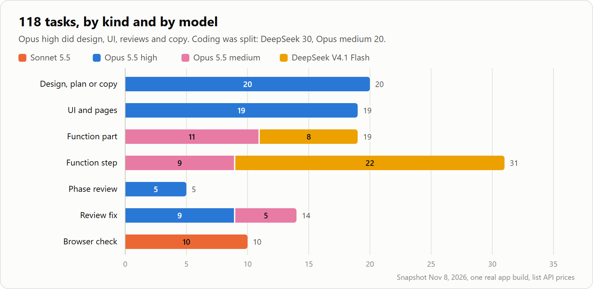
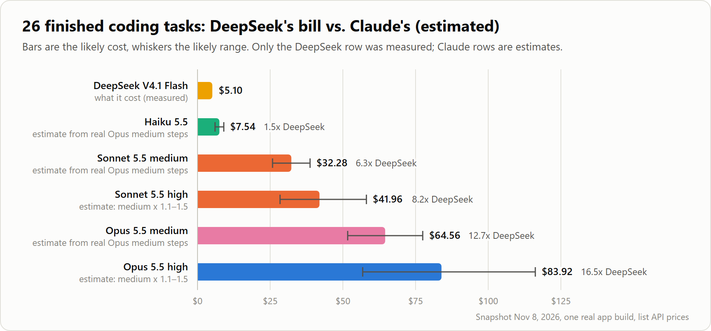
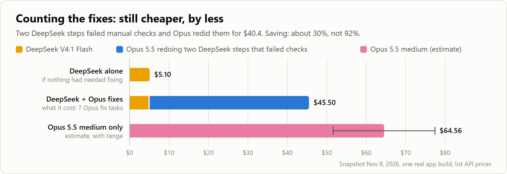
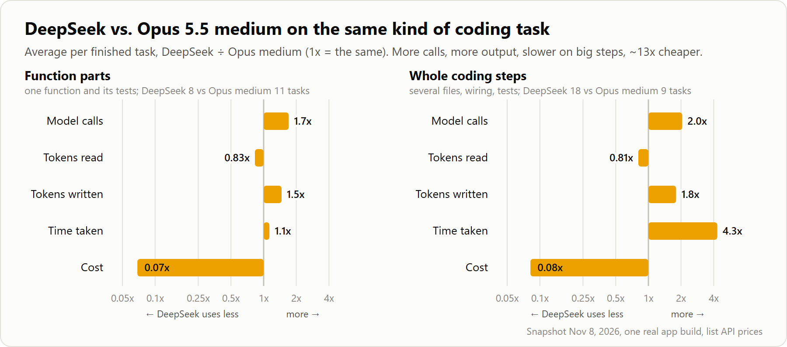
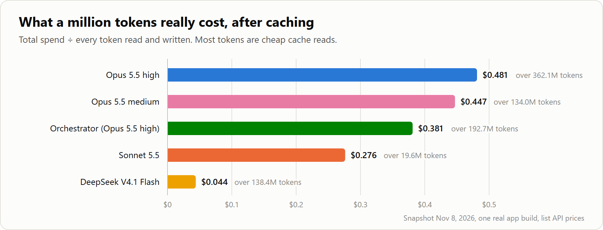
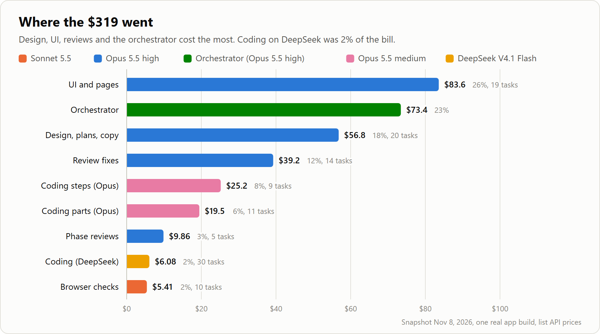

# Benchmark: DeepSeek on Fireworks vs. Claude for coding steps

**TL;DR.** In one real build run on a real app, DeepSeek V4.1 Flash on
Fireworks did a quarter of the tasks for about 2% of the bill. For the coding
tasks it finished, it cost about **13x less than Opus 5.5 medium**. Two of its
steps then failed our own hand checks and had to be redone by Opus. Counting
those fixes, the saving shrinks from about 92% to about **30%**. It was also
slower on big steps.

This is a snapshot from 8 November 2026. The run is still going.

## The setup

The app is a web app in active development. It has a backend, a database,
background jobs and a UI. We gave Claude Code one long plan and one `/goal`
built by `/ag:goal-prompt-3rdparty`. The goal has been running for about two
days. It splits the work between models like this:

| Who | Model | What it did |
| --- | --- | --- |
| Orchestrator (the main thread) | Opus 5.5, high | Reads the plan, writes short briefs, starts builders, checks results, commits |
| Opus high subagents | Opus 5.5, high | Design and planning, UI pages, phase reviews, fixing failed steps, user-facing copy |
| Opus medium subagents | Opus 5.5, medium | Coding steps kept on Claude |
| DeepSeek builders | DeepSeek V4.1 Flash on Fireworks | Coding steps, run as headless Claude Code (`claude -p`) pointed at Fireworks |
| Browser checks | Sonnet 5.5 | Clicks through pages in Chrome, takes screenshots, reports what it saw |

The DeepSeek builders are still Claude Code: same tools, same prompt, same
repo. Only the model behind it changes, through `ANTHROPIC_BASE_URL`. See
[How the cheaper Fireworks models are called](../README.md#how-the-cheaper-fireworks-models-are-called).

Two kinds of coding task show up below:

- **Function part**: one piece of a step, for example the backend half of a
  screen whose UI Opus builds.
- **Whole step**: a full coding step from the plan, with its own tests. The
  task chart calls it a function step.

## Who did the work, and who got paid

Each bar is 100%. Read it top to bottom:

- **Tasks.** DeepSeek did 25% of all tasks.
- **Model calls.** It made 36% of the calls. It works in more, smaller turns
  than Opus.
- **Tokens read.** It read 16% of the tokens.
- **Tokens written.** It wrote 33% of the output.
- **Cost.** It was about **2%** of the money.

Opus high is the big spender at 55%. That is design, UI, reviews and fixes,
which we keep on Opus on purpose. The orchestrator is another 23%.

The 118 tasks by kind. Design, UI, phase reviews and browser checks never left
Claude. Coding is where the models met: **DeepSeek did 30 coding tasks, Opus
medium did 20**. Review fixes went to Opus (9 at high, 5 at medium).

## The savings

DeepSeek finished 26 coding tasks for **$5.10**. What would the same 26 tasks
have cost on Claude? We used the run's own Opus medium builders as the
yardstick. On average they cost $1.77 per function part and $2.80 per whole
step. Those averages are multiplied by the tasks DeepSeek finished.

| Builder | Estimated cost | vs. DeepSeek |
| --- | --- | --- |
| DeepSeek V4.1 Flash (actual) | $5.10 | 1x |
| Haiku 5.5 | $7.54 | 1.5x |
| Sonnet 5.5 medium | $32.28 | 6.3x |
| Sonnet 5.5 high | $41.96 | 8.2x |
| Opus 5.5 medium | $64.56 | 12.7x |
| Opus 5.5 high | $83.92 | 16.5x |

Haiku is the only Claude model in the same price range. It is not 40x cheaper
than Opus here, because many agent turns carry over 100K tokens of context, and
above 100K Haiku costs five times more.

**This is the number that counts.** Two of DeepSeek's whole steps failed our
hand checks. Opus redid them in 7 tasks for **$40.40**.
DeepSeek plus those fixes comes to **$45.50**, against about $64.56 for Opus
medium doing it all. That is a saving of about **30%**, not 92%.

Two things could move that number either way:

- Opus medium fails steps too. Its own fix cost is not in the $64.56.
- More fixes may follow as the run goes on.

## Tokens: how differently the models work

Each bar is DeepSeek divided by Opus medium, per finished task. 1x means the
same. Below 1x means DeepSeek used less.

| Per task, DeepSeek ÷ Opus medium | Function part (8 vs. 11 tasks) | Whole step (18 vs. 9 tasks) |
| --- | --- | --- |
| Model calls | 1.7x | 2.0x |
| Tokens read | 0.83x | 0.81x |
| Tokens written | 1.5x | 1.8x |
| Time | 1.1x | **4.3x** |
| Cost | **0.07x** | **0.08x** |

What this says:

- DeepSeek makes about **twice as many calls** and **writes more**, but
  **reads a little less**.
- On small tasks it is about as fast as Opus. On whole steps it is **4.3x
  slower**: 41 minutes on average, against 10 for Opus.
- It still costs **7–8% of Opus** per task, so about 13x cheaper.

List prices make output look like the main cost. In agent work it is not.
Almost everything a builder reads is cached context from the turn before, and
cache reads are cheap. So we divided each model's real bill by every token it
read and wrote:

| Who | Real cost per million tokens | Tokens |
| --- | --- | --- |
| Opus 5.5 high | $0.481 | 362.1M |
| Opus 5.5 medium | $0.447 | 134.0M |
| Orchestrator (Opus 5.5 high) | $0.381 | 192.7M |
| Sonnet 5.5 | $0.276 | 19.6M |
| DeepSeek V4.1 Flash | **$0.044** | 138.4M |

A token through DeepSeek cost about **10x less** than one through Opus.

## Where the money went

The whole goal cost **$319** so far. Research before the goal cost another
$25.59, which is left out.

| Work | Cost | Share | Tasks |
| --- | --- | --- | --- |
| UI pages (Opus high) | $83.60 | 26% | 19 |
| Orchestrator | $73.40 | 23% | — |
| Design, plans and copy (Opus high) | $56.80 | 18% | 20 |
| Review fixes (Opus) | $39.20 | 12% | 14 |
| Whole coding steps (Opus medium) | $25.20 | 8% | 9 |
| Function parts (Opus medium) | $19.50 | 6% | 11 |
| Phase reviews (Opus high) | $9.86 | 3% | 5 |
| Coding on DeepSeek | $6.08 | 2% | 30 |
| Browser checks (Sonnet) | $5.41 | 2% | 10 |

The lesson for us: cheap builders shrink the coding bill, but **coding was not
most of the bill**. UI, design, the orchestrator and fixes are. The next saving
has to come from there.

## The whole run in numbers

| | |
| --- | --- |
| Tasks | 118 |
| Model calls | 9,368 |
| Tokens read | 840.2M |
| Tokens written | 6.6M |
| Cost of the goal | $319 |
| DeepSeek runs | 30 (26 ended, 4 still running at the snapshot) |
| Cost of one DeepSeek run | $0.07 to $0.57 |
| Longest DeepSeek run | 230 minutes |

## Caveats

- **One app, one run, small samples.** The ratio rests on 8 vs. 11 function
  parts and 18 vs. 9 whole steps. The Claude estimates carry a ±20% range.
- **The high-effort figures are assumed.** Opus high and Sonnet high are Opus
  medium's cost times 1.1 to 1.5 (1.3 shown). We did not measure them.
- **Two DeepSeek steps failed hand checks** and Opus redid them, as shown
  above. Review fixes are not split by whose code they fixed.
- **Fireworks limits.** One DeepSeek fix run stopped after 70 minutes when
  Fireworks suspended the account at its monthly spending limit (HTTP 412).
  A daily cap was also hit. Neither was a code failure, but both stop a run.
  That run is still counted among the 26.
- **Claude Code shows the wrong cost for DeepSeek.** It prices every model as
  Claude, so it showed $173 for the DeepSeek runs. The real Fireworks cost was
  $6.08.
- **This used the older model**, `deepseek-v4p1-flash`. The plugin now
  defaults to `deepseek-v4p1-flash-1017` at the same price.
- **Browser checks ran on Sonnet only**, so Sonnet has no coding numbers here.

## How we measured

- **Tokens and calls** come from Claude Code's own session logs for every
  subagent and the main thread, and from the Fireworks launcher's log for each
  DeepSeek run.
- **Claude cost** is each logged turn priced at list price: uncached input,
  cache writes (5-minute and 1-hour), cache reads and output.
- **DeepSeek cost** is Fireworks' price. Fireworks has no cache-write fee.
- **The Claude estimates** for DeepSeek's 26 tasks use the average real Opus
  medium task of the same kind, from this run. Sonnet and Haiku are those same
  Opus turns at their prices.

List prices per million tokens:

| Model | Input | Cache write (5 min / 1 h) | Cache read | Output |
| --- | --- | --- | --- | --- |
| Opus 5.5 | $4 | $5 / $8 | $0.20 | $20 |
| Sonnet 5.5 | $2 | $2.50 / $4 | $0.10 | $10 |
| Haiku 5.5, prompt up to 100K | $0.10 | $0.125 / $0.20 | $0.01 | $0.50 |
| Haiku 5.5, prompt over 100K | $0.50 | $0.625 / $1 | $0.05 | $2.50 |
| DeepSeek V4.1 Flash (Fireworks) | $0.30 | none | $0.006 | $1.20 |
