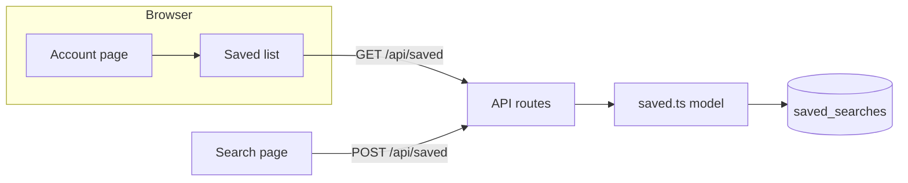
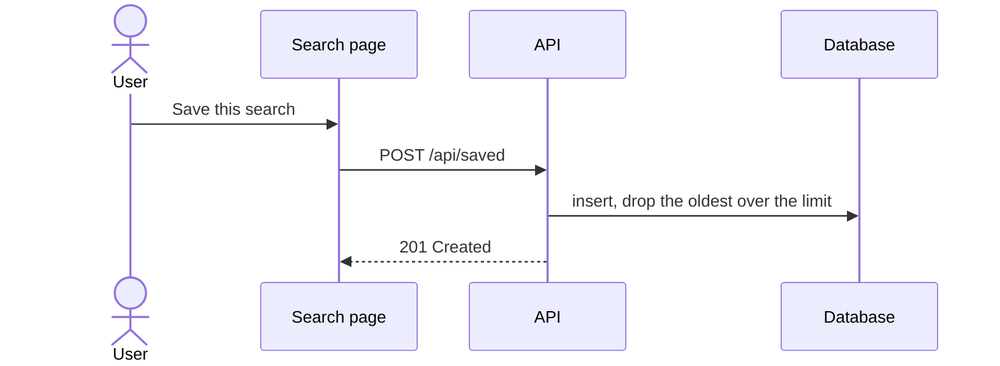

# Saved searches

A short example of the plan format /ag:plan writes. It lives in its own folder,
`plans/20261115-saved-searches/plan.md`, and `plan-page.mjs render` makes `plan.html` beside it.

## Goal

Signed-in users can save a search and run it again from their account page.

## Context

- Search lives in `src/search/`; the account page is `src/account/AccountPage.tsx`.
- Users are already stored in `users`; there is no table for saved items yet.

## Solution design

One new table, two API routes and one list on the account page. Nothing changes in search itself.

### Architecture

### High-level design

- Data: `saved_searches (id, user_id, query, created_at)`, indexed on `user_id`.
- API: `POST /api/saved` saves the current query; `GET /api/saved` lists the user's own, newest first.

### Screens (UX and UI)

- The Save button sits beside the search box; after a save it reads "Saved".
- The account page lists searches with Run and Delete; the empty state says how to save one.

### Technical implementation

- The user id comes from the session, never from the request body.
- Risk: a long query string; it is cut to 500 characters before it is stored.

## Phase 1: Store and list saved searches

Status: todo
Gate: the API tests pass and a saved search comes back after a restart.

### 1.1 Saved-search table and model

- Files: `db/migrations/`, `src/search/saved.ts`
- Acceptance: a migration adds `saved_searches (id, user_id, query, created_at)`; `saveSearch` and `listSaved` are tested.
- Size: S
- Status: todo

### 1.2 API routes

- Files: `src/api/saved.ts`, `src/api/saved.test.ts`
- Design: High-level design, Technical implementation
- Acceptance: `POST /api/saved` and `GET /api/saved` work for the signed-in user only; another user's searches are never returned.
- Size: M
- Status: todo

## Phase 2: The account page

Status: todo
Gate: the user signs off the page from screenshots at 1440 and 390.

### 2.1 Saved searches on the account page

- Files: `src/account/AccountPage.tsx`, `src/account/SavedList.tsx`
- Acceptance: the list shows each search with Run and Delete; empty state says how to save one.
- Size: M
- Status: todo

### 2.1-ui Screenshots for sign-off

- Acceptance: screenshots at 1440 and 390 on one review page.
- Size: S
- Status: todo

## Open questions

Each question has an id, its options and a default: the plan goes ahead with the default if the user says nothing.

- **Q1.** How many saved searches may a user keep?
  - A. 20, the oldest is dropped with a notice (recommended)
  - B. No limit
  - C. 5
- **Q2.** Should a saved search alert the user when new results appear? Default: B.
  - A. Yes, by email once a day
  - B. Not now; it goes under Later

## Later

- Alerts for new results.
- Sharing a saved search by link.

## Where the run stands
